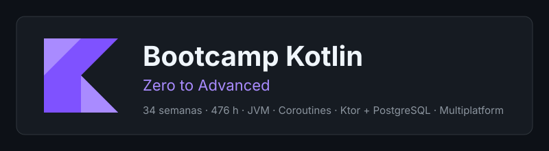

<p align="center">
  
</p>

<p align="center">
  <a href="LICENSE"></a>
  
  
  
  
  
</p>

<p align="center">
  <a href="README_EN.md"></a>
</p>

---

## 📋 Descripción

Bootcamp de **34 semanas** sobre **Kotlin**, desde **cero absoluto** —nunca has
programado— hasta un nivel **avanzado**: el lenguaje a fondo, la JVM, coroutines y Flow,
un servicio backend con **Ktor y PostgreSQL** listo para producción, **Kotlin
Multiplatform** y metaprogramación con KSP. Autoestudio, **14 horas por semana**, todo
verificable con tests.

Android no entra aquí: tiene su propio bootcamp, `bc-android-kotlin`.

### 🎯 Al terminar sabrás

- Escribir Kotlin idiomático: null safety, tipos sellados, genéricos, extensiones, DSLs.
- Construir y probar proyectos con Gradle Kotlin DSL, kotest y MockK.
- Programar concurrencia correcta con coroutines estructuradas, Flow y channels.
- Diseñar, asegurar, probar y desplegar una API REST con Ktor, Exposed y PostgreSQL.
- Compartir código entre JVM, escritorio y web con Kotlin Multiplatform.
- Medir rendimiento con JMH y generar código con KSP.

## 🗓️ Estructura

| Fase | Semanas | Horas | Qué aprendes |
| ---- | ------- | ----- | ------------ |
| 1 · Fundamentos | 01-06 | 84 | Toolchain, tipos, control de flujo, null safety, colecciones, lambdas |
| 2 · POO y tipos | 07-12 | 84 | Clases, herencia, sealed y data classes, genéricos, delegación, DSLs |
| 3 · Ecosistema JVM y calidad | 13-17 | 70 | Gradle, testing, interop Java, serialización, calidad automatizada |
| 4 · Concurrencia | 18-21 | 56 | Coroutines, cancelación, Flow, channels |
| 5 · Backend con Ktor | 22-28 | 98 | Ktor, PostgreSQL, arquitectura, seguridad, Testcontainers, producción |
| 6 · Multiplatform y avanzado | 29-34 | 84 | KMP, Compose Multiplatform, KSP, rendimiento, proyecto final |

Índice completo con el estado de cada semana: **[bootcamp/README.md](bootcamp/README.md)**.

### Cada semana (14 h)

| Parte | Tiempo | Contenido |
| ----- | ------ | --------- |
| `1-teoria/` | 3 h | Conceptos con ejemplos ejecutables paso a paso y diagramas |
| `2-practicas/` | 6 h | Ejercicios guiados: tests ya escritos que pones en verde paso a paso |
| `3-proyecto/` | 4 h | Una capa nueva del sistema de tu dominio |
| Evaluación y recursos | 1 h | Autoevaluación, libros, videos y glosario |

Evaluación: Conocimiento 30 % · Desempeño 40 % · Producto 30 %, con **mínimo 70 % en
cada una**.

## 🚀 Inicio rápido

Solo necesitas **Docker** y **git** ([guía completa](docs/setup.md)).

```bash
git clone https://github.com/ergrato-dev/bc-kotlin.git
cd bc-kotlin
docker build -t bc-kotlin-dev docker
docker run --rm bc-kotlin-dev kotlinc -version
```

Si la última línea imprime `info: kotlinc-jvm 2.4.21`, empieza por la
[Semana 01](bootcamp/README.md).

## 🏛️ Proyecto hilo conductor y dominios únicos

Durante todo el bootcamp construyes **un solo sistema** en el dominio que **te asigna
el instructor** ([cómo funciona](docs/proyecto-hilo-conductor.md)). Dos aprendices no
comparten dominio: copiar el trabajo de otro anula la entrega.

## 🛠️ Stack

Kotlin 2.4 · JDK 25 LTS · Gradle 9 (Kotlin DSL) · kotlin-test / kotest / MockK ·
kotlinx.coroutines · Ktor · Exposed · Flyway · PostgreSQL · Testcontainers · Docker
(`ubuntu:24.04`) · GitHub Actions. Versiones exactas en
[docs/stack-versions.md](docs/stack-versions.md).

## 📄 Licencia

[CC BY-NC-SA 4.0](LICENSE). Puedes usar y adaptar el material sin fines comerciales,
citando la fuente y compartiendo con la misma licencia.

## 🤝 Contribuir

Lee [CONTRIBUTING.md](CONTRIBUTING.md), el [código de conducta](CODE_OF_CONDUCT.md) y la
[política de seguridad](SECURITY.md).
