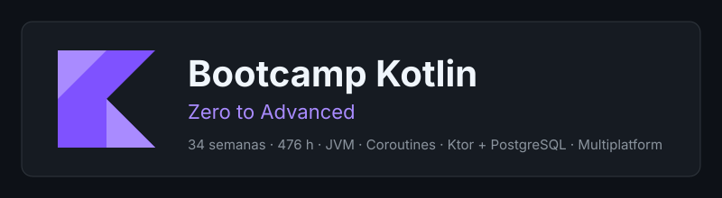

<p align="center">
  
</p>

# Kotlin Zero to Advanced Bootcamp

A **34-week, 476-hour** self-study bootcamp (14 h/week) that takes you from never having
programmed to advanced Kotlin: the language in depth, the JVM, coroutines and Flow, a
production-ready **Ktor + PostgreSQL** backend, **Kotlin Multiplatform**, KSP and
performance work. Android is out of scope (see `bc-android-kotlin`).

**The course content is written in Spanish.** Code, identifiers and commit messages are
in English.

| Phase | Weeks | Topics |
| ----- | ----- | ------ |
| 1 · Fundamentals | 01-06 | Toolchain, types, control flow, null safety, collections, lambdas |
| 2 · OOP and types | 07-12 | Classes, inheritance, sealed/data classes, generics, delegation, DSLs |
| 3 · JVM ecosystem and quality | 13-17 | Gradle, testing, Java interop, serialization, static analysis |
| 4 · Concurrency | 18-21 | Coroutines, cancellation, Flow, channels |
| 5 · Ktor backend | 22-28 | Ktor, PostgreSQL, architecture, security, Testcontainers, production |
| 6 · Multiplatform and advanced | 29-34 | KMP, Compose Multiplatform, KSP, performance, capstone |

Quick start: install Docker and git, then

```bash
git clone https://github.com/ergrato-dev/bc-kotlin.git && cd bc-kotlin
docker build -t bc-kotlin-dev docker
```

Weekly index: [bootcamp/README.md](bootcamp/README.md). License:
[CC BY-NC-SA 4.0](LICENSE).
