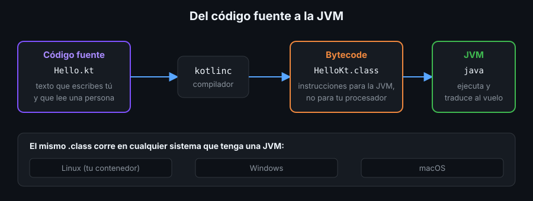

# Teoría 02 — Del código fuente a la JVM

## 🎯 Objetivos

- Explicar qué son la JVM, el bytecode y el JDK, y por qué Kotlin compila para la JVM.
- Compilar y ejecutar un programa a mano con `kotlinc` y `java`.
- Saber qué es un `.class`, un `.jar` y la biblioteca estándar de Kotlin.
- Ejecutar un script `.main.kts` sin compilar a mano.

---

## 1. Qué problema resuelve la JVM

En la [Teoría 01](01-que-es-programar-y-que-es-kotlin.md) viste que el procesador solo
entiende código máquina, y que ese código es **distinto** para cada tipo de procesador y
sistema operativo. Si compilaras directamente a código máquina, tendrías que compilar
una vez para Linux, otra para Windows, otra para macOS, y otra para cada procesador.

La **JVM** (*Java Virtual Machine*, máquina virtual de Java) resuelve eso con un paso
intermedio:

1. El compilador no genera código máquina, sino **bytecode**: instrucciones para una
   máquina imaginaria, la JVM, iguales en todos los sistemas.
2. En cada sistema hay instalada una JVM, que sí sabe hablar con ese procesador. La JVM
   lee el bytecode y lo convierte en código máquina **mientras el programa se ejecuta**.

Resultado: compilas una vez y el mismo archivo corre en cualquier sistema con JVM.



La JVM nació para Java en 1995. Kotlin la reutiliza: su compilador genera el mismo tipo
de bytecode que Java. Por eso Kotlin y Java pueden usar el código del otro.

## 2. Cómo funciona: las piezas

| Pieza | Qué es | En tu contenedor |
| ----- | ------ | ---------------- |
| **JVM** | El programa que ejecuta bytecode | Viene dentro del JDK |
| **JDK** (*Java Development Kit*) | La JVM más las herramientas de desarrollo: `java` (lanza la JVM), `javap` (inspecciona bytecode), `jar` (empaqueta) | OpenJDK 25 |
| **`kotlinc`** | El compilador de Kotlin para la JVM | Kotlin 2.4.21 |
| **Bytecode** | Instrucciones para la JVM | Archivos `.class` |
| **Biblioteca estándar** (*standard library*, `kotlin-stdlib`) | Código ya escrito que trae Kotlin: `println`, textos, listas, matemáticas... | `/opt/kotlinc/lib/kotlin-stdlib.jar` |
| **JAR** (*Java ARchive*) | Un archivo comprimido que agrupa muchos `.class` | Archivos `.jar` |

**LTS** (*Long-Term Support*): una versión del JDK con soporte de seguridad durante
años. El JDK 25 es LTS; por eso es el del bootcamp.

## 3. Cómo se hace: compilar a mano

Todo lo que sigue se ejecuta **dentro del contenedor** ([Teoría 03](03-el-contenedor-de-desarrollo.md)
explica cómo entrar). Lo practicas paso a paso en el
[Ejercicio 01](../2-practicas/ejercicio-01-compilar-a-mano/README.md).

### 3.1 El código fuente

Archivo `Hello.kt`:

```kotlin
fun main() {
    println("Hola, Kotlin")
}
```

### 3.2 Compilar

```bash
kotlinc Hello.kt
```

No imprime nada si todo va bien (tarda unos segundos: el compilador también es un
programa de la JVM y tiene que arrancar). Mira qué creó:

```bash
ls
```

```
Hello.kt  HelloKt.class  META-INF
```

- `HelloKt.class`: el bytecode. El nombre sale del archivo: `Hello.kt` → clase `HelloKt`.
  Una **clase** es la unidad en la que la JVM organiza el bytecode; las estudias a fondo
  en la semana 07. Hoy basta con saber que tu `main` vive dentro de `HelloKt`.
- `META-INF/main.kotlin_module`: información que Kotlin guarda para sí mismo. No la tocas.

### 3.3 Ejecutar con la JVM

```bash
java -cp .:/opt/kotlinc/lib/kotlin-stdlib.jar HelloKt
```

```
Hola, Kotlin
```

| Parte | Qué hace |
| ----- | -------- |
| `java` | Arranca la JVM |
| `-cp` | *classpath*: la lista de lugares donde la JVM busca bytecode, separados por `:` |
| `.` | La carpeta actual (donde está `HelloKt.class`) |
| `/opt/kotlinc/lib/kotlin-stdlib.jar` | La biblioteca estándar de Kotlin |
| `HelloKt` | La clase que contiene `main`. Sin `.class` al final |

Este programa tan corto funcionaría incluso sin la biblioteca estándar en el classpath,
porque el compilador traduce `println` directamente a la instrucción de Java equivalente.
En cuanto uses algo más de la biblioteca, sin ella la JVM falla. Ponla siempre.

### 3.4 Ver el bytecode por fuera

```bash
javap HelloKt.class
```

```
Compiled from "Hello.kt"
public final class HelloKt {
  public static final void main();
  public static void main(java.lang.String[]);
}
```

`javap` muestra qué hay dentro del `.class`. Dos `main`: el tuyo, y uno que añade el
compilador con la forma exacta que la JVM busca para arrancar un programa. Hoy solo
importa verlo; en la semana 15 lees bytecode instrucción a instrucción.

### 3.5 Empaquetar en un JAR ejecutable

```bash
kotlinc Hello.kt -include-runtime -d hello.jar
java -jar hello.jar
```

```
Hola, Kotlin
```

- `-include-runtime`: mete la biblioteca estándar dentro del JAR.
- `-d hello.jar`: el destino (*destination*). Si termina en `.jar`, empaqueta.
- `java -jar`: ejecuta un JAR que sabe cuál es su clase con `main`. Ya no necesitas `-cp`.

El JAR pesa unos 5,4 MB: casi todo es la biblioteca estándar. Es el precio de un archivo
que corre en cualquier JVM sin nada más.

## 4. Scripts: Kotlin sin compilar a mano

Para tareas pequeñas existe el **script Kotlin**: un archivo que termina en `.main.kts`,
sin `fun main`, que se ejecuta de arriba abajo.

Archivo `hello.main.kts`:

```kotlin
println("Hola desde un script")
println("Sin main y sin compilar a mano")
```

```bash
kotlin hello.main.kts
```

```
Hola desde un script
Sin main y sin compilar a mano
```

`kotlin` compila el script en memoria y lo ejecuta en el mismo paso. Útil para
automatizar algo rápido; para programas de verdad usas proyectos Gradle
([Teoría 05](05-gradle-y-el-wrapper.md)), porque compilan una vez, se prueban y se
empaquetan.

## 5. Antipatrones

- ❌ **Confundir `kotlinc` con `kotlin` o con `java`.** `kotlinc` traduce (`.kt` →
  `.class`). `java` ejecuta bytecode. `kotlin` ejecuta scripts o bytecode Kotlin.
- ❌ **Escribir `java HelloKt.class`.** La JVM espera el nombre de la clase, no del archivo:
  ```
  Error: Could not find or load main class HelloKt.class
  ```
- ❌ **Editar o versionar los `.class`.** Son un resultado de compilar: se regeneran. El
  `.gitignore` del bootcamp los excluye.

## 6. Trucos

- `kotlinc -version` y `java -version` dicen qué versión estás usando. Es lo primero que
  se comprueba cuando algo "funciona en mi máquina" y no en otra.
- `-cp` también se puede escribir `-classpath`. Es lo mismo.

## ✅ Checklist

- [ ] Sé qué es la JVM y qué problema resuelve el bytecode
- [ ] Distingo JDK, JVM, `kotlinc`, `java` y la biblioteca estándar
- [ ] Sé compilar con `kotlinc` y ejecutar con `java -cp`
- [ ] Sé crear un JAR ejecutable y lanzarlo con `java -jar`
- [ ] Sé ejecutar un script `.main.kts`

---

| Anterior | Actual | Siguiente |
| -------- | ------ | --------- |
| [← Teoría 01 — Qué es programar y qué es Kotlin](01-que-es-programar-y-que-es-kotlin.md) | **Teoría 02 — Del código fuente a la JVM** | [Teoría 03 — El contenedor de desarrollo →](03-el-contenedor-de-desarrollo.md) |
