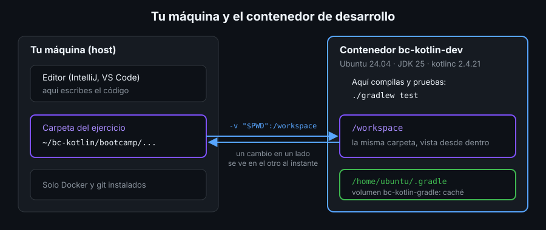

# Teoría 03 — El contenedor de desarrollo

## 🎯 Objetivos

- Moverte por carpetas en la terminal con `pwd`, `ls` y `cd`.
- Explicar qué son una imagen, un contenedor y un volumen de Docker.
- Construir la imagen `bc-kotlin-dev` y trabajar dentro de ella.
- Entender, línea a línea, el `Dockerfile` del bootcamp.

---

## 1. Qué problema resuelve un contenedor

Para compilar Kotlin necesitas un JDK, el compilador y Gradle, en versiones concretas.
Si cada aprendiz instala versiones distintas, el mismo ejercicio da errores distintos
en cada máquina, y nadie sabe si el fallo está en el código o en la instalación.

Un **contenedor** es un entorno aislado, con su propio sistema de archivos y sus propios
programas, que corre dentro de tu máquina. Todos los aprendices usan **el mismo**
contenedor, construido con las mismas instrucciones. Si funciona dentro, funciona en la
corrección.

**Docker** es la herramienta que construye y ejecuta contenedores. Es lo único (junto con
git) que instalas en tu máquina ([`docs/setup.md`](../../../docs/setup.md)).

## 2. Antes de nada: la terminal

Vas a escribir comandos en una **terminal**. Cada comando es una línea que termina con
Enter. Los tres que necesitas para moverte:

| Comando | Qué hace | Ejemplo de salida |
| ------- | -------- | ----------------- |
| `pwd` | *print working directory*: dice en qué carpeta estás | `/home/ada/bc-kotlin` |
| `ls` | *list*: muestra lo que hay en la carpeta actual | `README.md  bootcamp  docker  docs` |
| `cd carpeta` | *change directory*: entra en una carpeta | (nada) |
| `cd ..` | Sube a la carpeta que contiene a la actual | (nada) |

Una **ruta** (*path*) es la dirección de un archivo o carpeta. `/home/ada/bc-kotlin` es
una ruta **absoluta** (empieza en `/`, la raíz). `bootcamp/README.md` es **relativa**:
se cuenta desde la carpeta actual.

Truco: escribe las primeras letras de una carpeta y pulsa Tab; la terminal completa el
nombre.

## 3. Cómo funciona: imagen, contenedor y volumen

| Concepto | Qué es | Analogía |
| -------- | ------ | -------- |
| **Dockerfile** | Archivo de texto con las instrucciones para preparar el entorno | La receta |
| **Imagen** | El resultado de seguir el Dockerfile: un sistema de archivos congelado | El plato preparado y guardado |
| **Contenedor** | Una imagen en ejecución. Puedes lanzar muchos a partir de una imagen | Una porción servida |
| **Volumen** | Almacenamiento que vive fuera del contenedor y sobrevive cuando este se borra | La despensa |
| **Montar** (*mount*) | Hacer que una carpeta de tu máquina aparezca dentro del contenedor | Una ventana entre los dos |



A tu máquina se la llama **host** (anfitrión). La regla del bootcamp:

- **Editas en el host**, con tu editor.
- **Compilas y pruebas dentro del contenedor**, sobre la misma carpeta montada.

## 4. Cómo se hace

### 4.1 Construir la imagen (una vez)

Desde la raíz del repositorio (`pwd` debe terminar en `bc-kotlin`):

```bash
docker build -t bc-kotlin-dev docker
```

| Parte | Qué hace |
| ----- | -------- |
| `docker build` | Construye una imagen siguiendo un Dockerfile |
| `-t bc-kotlin-dev` | *tag*: el nombre que le das a la imagen |
| `docker` | La carpeta donde está el `Dockerfile` |

Comprueba que existe:

```bash
docker run --rm bc-kotlin-dev kotlinc -version
```

```
info: kotlinc-jvm 2.4.21 (JRE 25.0.5.0.3+1-1-24.04.1-Ubuntu)
```

`docker run imagen comando` lanza un contenedor, ejecuta ese comando y termina.

### 4.2 Entrar en el contenedor

```bash
docker run --rm -it \
  -v bc-kotlin-gradle:/home/ubuntu/.gradle \
  -v "$PWD":/workspace \
  bc-kotlin-dev
```

La `\` al final de una línea dice a la terminal "el comando sigue en la línea de abajo".

| Parte | Qué hace | Para qué |
| ----- | -------- | -------- |
| `--rm` | Borra el contenedor al salir | No acumular contenedores parados |
| `-it` | Terminal interactiva | Poder escribir comandos dentro |
| `-v bc-kotlin-gradle:/home/ubuntu/.gradle` | Monta el volumen `bc-kotlin-gradle` en la carpeta de caché de Gradle | Gradle descarga sus cosas una vez, no cada vez que entras |
| `-v "$PWD":/workspace` | Monta la carpeta actual del host en `/workspace` | Ver dentro lo que editas fuera |
| `bc-kotlin-dev` | La imagen | |

`$PWD` es una **variable** de la terminal que contiene la carpeta actual. Las comillas
evitan problemas si la ruta tiene espacios.

Dentro verás un **prompt** (el texto antes del cursor) como `ubuntu@3f2a...:/workspace$`.
`ubuntu` es el usuario dentro del contenedor. Para salir: `exit`.

Ese comando es largo; crea un **alias** (un nombre corto para un comando) en tu host:

```bash
alias kdev='docker run --rm -it -v bc-kotlin-gradle:/home/ubuntu/.gradle -v "$PWD":/workspace bc-kotlin-dev'
```

Añádelo al final de `~/.bashrc` (o `~/.zshrc` si usas zsh) para que exista siempre.
Desde entonces: `cd` a la carpeta del ejercicio y `kdev`.

## 5. El Dockerfile, por partes

El archivo completo está en [`docker/Dockerfile`](../../../docker/Dockerfile), con sus
comentarios. Aquí va por partes, algunas resumidas en menos líneas.

```dockerfile
FROM ubuntu:24.04
```

Parte de la imagen oficial de Ubuntu 24.04. Todo lo demás se añade encima.

```dockerfile
ARG KOTLIN_VERSION=2.4.21
ENV DEBIAN_FRONTEND=noninteractive LANG=C.UTF-8 PATH=/opt/kotlinc/bin:$PATH
```

`ARG`: un valor que se usa al construir. `ENV`: variables que existen dentro del
contenedor. `LANG=C.UTF-8` hace que las tildes y la ñ se impriman bien. `PATH` es la
lista de carpetas donde la terminal busca programas; se le añade la de `kotlinc`.

```dockerfile
RUN apt-get update \
    && apt-get install -y --no-install-recommends \
        openjdk-25-jdk-headless ca-certificates curl unzip git \
    && rm -rf /var/lib/apt/lists/*
```

`RUN` ejecuta un comando al construir. `apt-get` es el instalador de Ubuntu: instala el
JDK 25 (*headless*: sin componentes gráficos) y utilidades. Al final borra la lista de
paquetes descargada para que la imagen pese menos.

```dockerfile
RUN curl -fsSL -o /tmp/kotlinc.zip "https://github.com/JetBrains/kotlin/releases/download/v${KOTLIN_VERSION}/kotlin-compiler-${KOTLIN_VERSION}.zip" \
    && unzip -q /tmp/kotlinc.zip -d /opt && rm /tmp/kotlinc.zip
```

Descarga el compilador oficial desde GitHub y lo descomprime en `/opt/kotlinc`.

```dockerfile
RUN mkdir -p /home/ubuntu/.gradle && chown ubuntu:ubuntu /home/ubuntu/.gradle
USER ubuntu
WORKDIR /workspace
```

Prepara la carpeta del caché de Gradle, cambia al usuario sin privilegios `ubuntu` (no
`root`, el administrador: un error tuyo no puede romper el sistema del contenedor) y fija
`/workspace` como carpeta inicial.

## 6. Antipatrones

- ❌ **Instalar cosas dentro de un contenedor en marcha.** Con `--rm` se pierden al salir.
  Si hace falta algo de verdad, va al Dockerfile.
- ❌ **Lanzar el contenedor como root** (`--user root`). Los archivos que cree en tu
  carpeta quedarán con dueño `root` y tu editor no podrá modificarlos.
- ❌ **Olvidar `-v "$PWD":/workspace`.** El contenedor arranca con `/workspace` vacío: no
  ve tu código.

## 7. Trucos

- `docker images` lista tus imágenes; `docker volume ls`, tus volúmenes.
- Si el caché de Gradle se estropea: `docker volume rm bc-kotlin-gradle`. Se recrea solo.

## ✅ Checklist

- [ ] Me muevo por carpetas con `pwd`, `ls`, `cd` y `cd ..`
- [ ] Distingo Dockerfile, imagen, contenedor y volumen
- [ ] Sé construir `bc-kotlin-dev` y entrar con la carpeta montada
- [ ] Sé por qué edito en el host y compilo en el contenedor

---

| Anterior | Actual | Siguiente |
| -------- | ------ | --------- |
| [← Teoría 02 — Del código fuente a la JVM](02-del-codigo-fuente-a-la-jvm.md) | **Teoría 03 — El contenedor de desarrollo** | [Teoría 04 — Anatomía de un programa →](04-anatomia-de-un-programa.md) |
