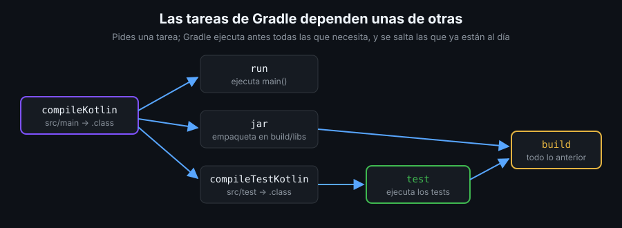

# Teoría 05 — Gradle y el wrapper

## 🎯 Objetivos

- Explicar qué es una herramienta de build y qué problema resuelve.
- Reconocer cada archivo de un proyecto Gradle del bootcamp.
- Usar el wrapper (`./gradlew`) para compilar, ejecutar, probar y empaquetar.
- Leer la salida de Gradle: tareas, `UP-TO-DATE`, `BUILD SUCCESSFUL` y `BUILD FAILED`.

---

## 1. Qué problema resuelve una herramienta de build

En la [Teoría 02](02-del-codigo-fuente-a-la-jvm.md) compilaste un archivo a mano. Un
proyecto real tiene decenas de archivos, usa bibliotecas de otras personas (que hay que
descargar en la versión correcta), tiene tests que se compilan aparte y se empaqueta para
distribuirse. Hacerlo a mano, cada vez y en el orden correcto, es imposible de sostener.

Una **herramienta de build** (*build tool*) automatiza todo eso a partir de un archivo de
configuración. **Gradle** es la herramienta de build estándar en Kotlin. Se configura en
Kotlin mismo (**Kotlin DSL**: archivos `.gradle.kts`).

Una **dependencia** (*dependency*) es una biblioteca que tu proyecto necesita. Gradle la
descarga de un **repositorio** de bibliotecas en internet; el principal es **Maven
Central**.

## 2. Cómo funciona: un proyecto del bootcamp

Cada ejercicio trae una carpeta `starter/` con esta forma:

```
starter/
├── settings.gradle.kts         # nombre del proyecto
├── build.gradle.kts            # cómo se construye
├── gradlew                     # el wrapper (Linux/macOS)
├── gradlew.bat                 # el wrapper (Windows)
├── gradle/wrapper/
│   ├── gradle-wrapper.jar      # programa mínimo que descarga Gradle
│   └── gradle-wrapper.properties  # qué versión de Gradle
└── src/
    ├── main/kotlin/Main.kt     # el código del programa
    └── test/kotlin/MainTest.kt # los tests
```

**Convención sobre configuración**: Gradle sabe, sin que se lo digas, que el código está
en `src/main/kotlin` y los tests en `src/test/kotlin`. Si respetas la estructura, no hay
que configurar rutas.

### 2.1 `settings.gradle.kts`

```kotlin
rootProject.name = "first-gradle-project"
```

El nombre del proyecto. Da nombre, por ejemplo, al JAR que se genera.

### 2.2 `build.gradle.kts`

```kotlin
plugins {
    kotlin("jvm") version "2.4.21"
    application
}
```

Un **plugin** añade capacidades a Gradle. `kotlin("jvm")` enseña a Gradle a compilar
Kotlin para la JVM, con el compilador 2.4.21. `application` añade la tarea `run` y el
empaquetado para ejecutar el programa.

```kotlin
repositories {
    mavenCentral()
}

dependencies {
    testImplementation(kotlin("test"))
}
```

De dónde se descargan las dependencias, y cuáles hay. `testImplementation` significa
"solo para los tests": `kotlin-test` no viaja con tu programa.

```kotlin
kotlin {
    jvmToolchain(25)
    compilerOptions {
        allWarningsAsErrors.set(true)
    }
}
```

`jvmToolchain(25)`: compila para el JDK 25. `allWarningsAsErrors`: todo warning detiene
la compilación. En el bootcamp el código sale limpio.

```kotlin
application {
    mainClass.set("MainKt")
}
```

La clase con `main`: `Main.kt` → `MainKt`, la misma regla que viste con `kotlinc`.

El bloque `tasks.test { ... }` del final configura cómo se muestran los resultados de
los tests. No hace falta tocarlo.

### 2.3 El wrapper

`gradlew` (*Gradle wrapper*) es un script que:

1. Lee en `gradle-wrapper.properties` qué versión de Gradle pide el proyecto (9.8.2).
2. La descarga la primera vez y la guarda en `~/.gradle` (en el contenedor, el volumen
   `bc-kotlin-gradle`).
3. La ejecuta con los argumentos que le pases.

Así nadie instala Gradle a mano y todos usan la misma versión. Siempre `./gradlew`,
nunca un `gradle` instalado aparte. El `./` delante significa "el programa que está en
esta carpeta".

## 3. Cómo se usa: las tareas

Gradle trabaja con **tareas** (*tasks*): unidades de trabajo con nombre. Tú pides una;
Gradle ejecuta antes todas las que esa necesita.



| Comando | Qué hace |
| ------- | -------- |
| `./gradlew run` | Compila y ejecuta `main` |
| `./gradlew test` | Compila programa y tests, y ejecuta los tests |
| `./gradlew build` | Compila, prueba y empaqueta. Falla si algún test falla |
| `./gradlew installDist` | Crea una versión instalable en `build/install/<nombre>/` |
| `./gradlew clean` | Borra la carpeta `build/`, donde Gradle deja todo lo que genera |
| `./gradlew tasks` | Lista las tareas disponibles |
| `./gradlew --version` | Versiones de Gradle, de su Kotlin interno y de la JVM |

### 3.1 Leer la salida

```
> Task :compileKotlin
> Task :classes UP-TO-DATE
> Task :run
Bootcamp Kotlin — Semana 01
BUILD SUCCESSFUL in 1s
```

- `> Task :nombre`: Gradle ejecuta esa tarea.
- `UP-TO-DATE`: la tarea ya estaba hecha y nada cambió desde entonces; se salta. Por
  eso la segunda ejecución es mucho más rápida.
- `NO-SOURCE`: no hay nada que procesar (por ejemplo, no hay código Java).
- `BUILD SUCCESSFUL` o `BUILD FAILED`: el resultado final.

La primera vez tarda bastante más (decenas de segundos): descarga Gradle, el plugin de
Kotlin y las dependencias, y arranca el **daemon**, un proceso de Gradle que se queda
vivo un rato para que los siguientes comandos vayan rápido. Verás:

```
Starting a Gradle Daemon (subsequent builds will be faster)
```

Para menos ruido, `-q` (*quiet*) solo muestra la salida del programa y los errores:

```bash
./gradlew -q run
```

### 3.2 Cuando falla

Si `main` lanza una excepción, `run` falla y lo dice:

```
> Task :run FAILED
Exception in thread "main" kotlin.NotImplementedError: An operation is not implemented: Paso 2
	at MainKt.main(Main.kt:7)
...
BUILD FAILED in 5s
```

Esto lo vas a ver mucho: en los ejercicios, cada paso sin resolver es un `TODO("Paso N")`,
que lanza `NotImplementedError` a propósito ([Teoría 06](06-que-es-un-test.md)).

### 3.3 Dos versiones de Kotlin

`./gradlew --version` muestra `Kotlin: 2.4.10`. No es un error: es el Kotlin que Gradle
usa **internamente** para leer los `.gradle.kts`. Tu código lo compila el plugin que
declaraste, `kotlin("jvm") version "2.4.21"`.

## 4. Antipatrones

- ❌ **Usar `gradle` en vez de `./gradlew`.** Usarías otra versión, o ninguna.
- ❌ **Versionar `build/` o `.gradle/`.** Se regeneran; el `.gitignore` los excluye.
- ❌ **Borrar `gradle-wrapper.jar`** porque "es un binario". Sin él, `./gradlew` no arranca.
- ❌ **Mover el código fuera de `src/main/kotlin`.** Gradle no lo encontrará y compilará
  un proyecto vacío sin quejarse.

## 5. Trucos

- `./gradlew run --console=plain` quita los colores y barras de progreso; útil para
  copiar la salida a un informe.
- Si el wrapper dice `Permission denied`: `chmod +x gradlew` le devuelve el permiso de
  ejecución.

## ✅ Checklist

- [ ] Sé qué es una herramienta de build, un plugin y una dependencia
- [ ] Reconozco cada archivo de un `starter/`
- [ ] Sé por qué se usa `./gradlew` y no `gradle`
- [ ] Uso `run`, `test`, `build`, `installDist` y `clean`
- [ ] Leo `UP-TO-DATE`, `BUILD SUCCESSFUL` y `BUILD FAILED`

---

| Anterior | Actual | Siguiente |
| -------- | ------ | --------- |
| [← Teoría 04 — Anatomía de un programa](04-anatomia-de-un-programa.md) | **Teoría 05 — Gradle y el wrapper** | [Teoría 06 — Qué es un test →](06-que-es-un-test.md) |
