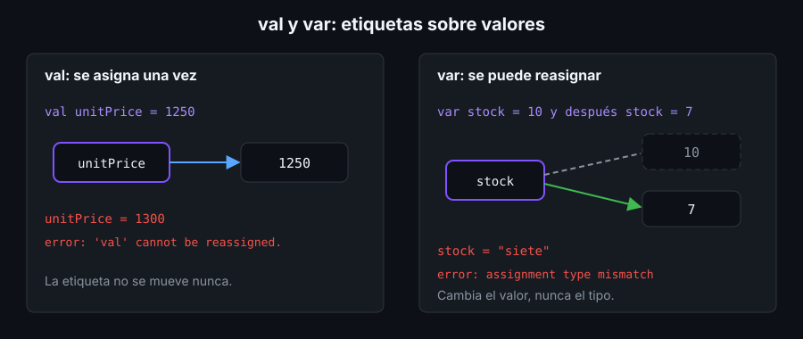

# Teoría 01 — Valores y variables

## 🎯 Objetivos

- Explicar qué es un valor y qué es una variable.
- Declarar variables de solo lectura con `val` y reasignables con `var`.
- Elegir entre `val` y `var` con un criterio claro.
- Imprimir una variable dentro de un texto con `$nombre`.
- Leer los errores `'val' cannot be reassigned` y `must be initialized`.

---

## 1. Qué problema resuelven las variables

En la semana 01, todo lo que imprimía tu programa estaba escrito tal cual dentro de los
`println`. Si el nombre del sistema aparecía en tres líneas, estaba escrito tres veces; si
cambiaba, había que cambiarlo en tres sitios y acordarse de todos.

Un programa útil trabaja con **datos**: un precio, una cantidad, un nombre. Necesita
guardarlos, darles un nombre y usarlos en varios sitios. Para eso existen las variables.

## 2. Cómo funciona

### 2.1 Valor

Un **valor** es un dato concreto: `3`, `12.5`, `"Kotlin"`, `true`. Ya los usaste: el
texto entre comillas de un `println` es un valor de tipo texto.

### 2.2 Variable

Una **variable** es un **nombre** que apunta a un valor. Cuando el programa encuentra el
nombre, usa el valor al que apunta.



Piensa en una etiqueta pegada a una caja con un dato dentro. Kotlin ofrece dos tipos de
etiqueta:

| Palabra reservada | Nombre | Qué permite |
| ----------------- | ------ | ----------- |
| `val` | *value*, valor | Se asigna una sola vez. Después, siempre apunta al mismo valor |
| `var` | *variable* | Se puede **reasignar**: apuntar después a otro valor |

**Asignar** es dar a una variable su valor con el signo `=`. **Reasignar** es asignarle
otro valor más tarde.

## 3. Cómo se escribe

### 3.1 Declarar con `val`

**Declarar** una variable es crearla: decir su nombre y, normalmente, su valor inicial.

```kotlin
fun main() {
    val language = "Kotlin"
    println(language)
}
```

| Pieza | Qué es |
| ----- | ------ |
| `val` | Variable de solo lectura |
| `language` | El nombre que eliges |
| `=` | Asignación: "apunta a" |
| `"Kotlin"` | El valor inicial |

`println(language)` no imprime la palabra `language`: imprime el valor al que apunta.
Sale `Kotlin`. Fíjate en que `language` va **sin comillas**: con comillas sería un texto,
sin comillas es un nombre.

### 3.2 Reasignar con `var`

```kotlin
fun main() {
    var stock = 10
    println(stock)
    stock = 7
    println(stock)
}
```

Sale `10` y después `7`. La segunda línea con `stock` no lleva `var`: la variable ya
existe, solo se le da otro valor. Escribir `var stock = 7` otra vez sería declarar una
segunda variable con el mismo nombre, y el compilador lo rechaza.

### 3.3 Intentar reasignar un `val`

Copia este archivo como `E1.kt` y compílalo con `kotlinc E1.kt` en el contenedor:

```kotlin
fun main() {
    val x = 5
    x = 6
    println(x)
}
```

El compilador responde:

```
E1.kt:3:5: error: 'val' cannot be reassigned.
```

Línea 3, columna 5: justo donde intentas cambiar `x`. (En los errores que verás esta
semana, `E1.kt`, `E2.kt`... son los nombres de los archivos de prueba con que se
generaron; en tu pantalla aparece el nombre de tu archivo.) Es un error **a tu favor**: si
declaraste `val`, es porque ese dato no debía cambiar, y el compilador lo vigila por ti.

### 3.4 Imprimir una variable dentro de un texto

Casi siempre quieres el dato acompañado de una explicación. Dentro de un string, `$`
seguido de un nombre de variable se sustituye por su valor:

```kotlin
fun main() {
    val language = "Kotlin"
    val year = 2016
    println("$language 1.0 salió en $year")
}
```

Sale `Kotlin 1.0 salió en 2016`. Esto se llama **plantilla de string** (*string
template*). En la [Teoría 05](05-strings-y-templates.md) verás todo lo que puede hacer;
por ahora basta con `$nombre`.

### 3.5 Declarar sin valor inicial

Puedes declarar primero y asignar después, pero antes de **usar** la variable tiene que
tener valor:

```kotlin
fun main() {
    var count: Int
    println(count)
}
```

```
E7.kt:3:13: error: variable 'count' must be initialized.
```

El `: Int` dice qué tipo de dato guardará (lo verás en la
[Teoría 02](02-tipos-basicos-e-inferencia.md)). Sin valor inicial, el compilador no
puede adivinarlo y necesita que lo escribas. En la práctica, casi siempre se declara con
el valor ya puesto.

### 3.6 Nombres de variables

| Regla | Ejemplo válido | Ejemplo inválido |
| ----- | -------------- | ---------------- |
| Empieza por letra o `_` | `price`, `_temp` | `2price` |
| Solo letras, dígitos y `_` | `unitPrice2` | `unit-price`, `unit price` |
| No es una palabra reservada | `value` | `val`, `fun`, `var` |
| Distingue mayúsculas | `price` y `Price` son dos nombres distintos | |

Además de las reglas, el bootcamp sigue estas **convenciones** (acuerdos para que todo el
código se lea igual):

- Nombres en **inglés**, como todo el código del bootcamp.
- **camelCase**: la primera palabra en minúsculas y cada palabra siguiente empieza en
  mayúscula: `unitPrice`, `totalWithTax`, `isAvailable`.
- El nombre dice **qué contiene**, no qué tipo tiene: `price`, no `number1`.

## 4. Cómo elegir: `val` por defecto

La regla del bootcamp es sencilla: **declara con `val`; cambia a `var` solo si el
programa necesita reasignar**.

```kotlin
fun main() {
    val unitPrice = 1250   // ¿Qué? precio de una unidad. No cambia en todo el programa.
    var stock = 10         // ¿Para qué? las unidades bajan con cada venta.
    stock = stock - 3      // ¿Impacto? desde aquí, stock vale 7.
    println("Precio: $unitPrice, stock: $stock")
}
```

Sale `Precio: 1250, stock: 7`. La línea `stock = stock - 3` se lee de derecha a
izquierda: primero se calcula `stock - 3` con el valor actual (10), y el resultado (7) se
guarda en `stock`.

¿Por qué `val` por defecto? Porque cuando lees un programa largo y ves `val`, sabes que
ese dato vale lo mismo en todas partes. Con `var` tienes que buscar todos los sitios donde
podría cambiar.

## 5. Antipatrones

- ❌ **`var` "por si acaso".** Si nunca se reasigna, es `val`. Un `var` innecesario
  obliga a quien lee a buscar cambios que no existen.
- ❌ **Nombres sin significado** (`a`, `x2`, `dato`). Dentro de una semana no sabrás qué
  guardaban.
- ❌ **Escribir el mismo valor en varios sitios.** Si el `21` del impuesto aparece en
  cinco líneas, un cambio de tarifa son cinco ediciones y un olvido.
- ❌ **Repetir `var` al reasignar.** `var stock = 7` en la segunda línea no reasigna:
  intenta declarar otra variable y no compila.

## 6. Trucos

- Si dudas entre `val` y `var`, escribe `val`. Si hace falta `var`, el compilador te lo
  dirá con `'val' cannot be reassigned`, y el cambio es de una palabra.
- Cuando el valor no cambia nunca y es una constante del programa (una tarifa, un nombre
  de versión), ponle un nombre que lo diga: `taxRatePercent`, no `n`.

## ✅ Checklist

- [ ] Sé qué es un valor y qué es una variable
- [ ] Declaro con `val` y con `var`, y sé reasignar sin repetir `var`
- [ ] Elijo `val` por defecto
- [ ] Imprimo variables dentro de un texto con `$nombre`
- [ ] Leo `'val' cannot be reassigned` y `must be initialized`
- [ ] Nombro variables en inglés y en camelCase

---

| Anterior | Actual | Siguiente |
| -------- | ------ | --------- |
| [← Semana 02 — README](../README.md) | **Teoría 01 — Valores y variables** | [Teoría 02 — Tipos básicos e inferencia →](02-tipos-basicos-e-inferencia.md) |
