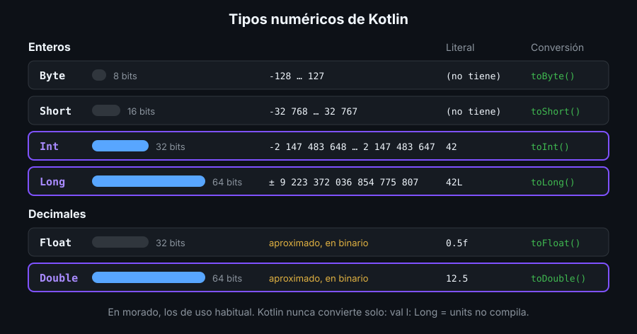

# Teoría 02 — Tipos básicos e inferencia

## 🎯 Objetivos

- Explicar qué es un tipo y por qué cada valor tiene uno.
- Usar `Int`, `Long`, `Double`, `Boolean`, `Char` y `String`, y saber cuándo usar cada uno.
- Escribir literales: `1_000`, `3L`, `12.5`, `'K'`, `"Kotlin"`.
- Entender la inferencia de tipos y cuándo escribir el tipo a mano.
- Leer los errores `initializer type mismatch` y `assignment type mismatch`.

---

## 1. Qué problema resuelven los tipos

Para la máquina, todo son bits. `65` puede ser un número, la letra `A` o parte de un
precio. El **tipo** dice qué es un valor y, por tanto, qué se puede hacer con él: dos
números se multiplican; dos textos no.

Kotlin es un lenguaje de **tipado estático**: el tipo de cada variable se fija al
compilar y no cambia. Si intentas guardar un texto donde va un número, el programa no
compila. El error aparece en tu pantalla, no en la de quien usa el programa.

## 2. Cómo funciona: los tipos básicos

| Tipo | Qué guarda | Literal de ejemplo | Úsalo para |
| ---- | ---------- | ------------------ | ---------- |
| `Int` | Entero de 32 bits | `42`, `-7`, `1_000_000` | Cantidades, contadores, edades |
| `Long` | Entero de 64 bits | `3_000_000_000`, `42L` | Importes en centavos, identificadores grandes |
| `Double` | Número con decimales (64 bits) | `12.5`, `3.0`, `1.5e-3` | Medidas: peso, distancia, temperatura |
| `Boolean` | Verdadero o falso | `true`, `false` | Estados de sí/no: disponible, activo |
| `Char` | Un solo carácter | `'K'`, `'ñ'`, `'7'` | Iniciales, separadores |
| `String` | Texto | `"Kotlin"`, `""` | Nombres, códigos, mensajes |

Un **literal** es un valor escrito directamente en el código. Un **bit** es la unidad
mínima de información, un 0 o un 1; con más bits caben números más grandes.

### 2.1 Los enteros y sus límites

Un `Int` tiene 32 bits y, por tanto, un máximo. Puedes consultarlo:

```kotlin
fun main() {
    println(Int.MAX_VALUE)
    println(Int.MIN_VALUE)
    println(Long.MAX_VALUE)
}
```

```
2147483647
-2147483648
9223372036854775807
```



Un `Int` llega a algo más de 2 100 millones. Parece mucho, pero un importe de 21 millones
expresado en centavos ya no cabe. Por eso los importes del bootcamp se guardan en `Long`
(la [Teoría 04](04-conversiones-y-dinero.md) lo explica).

Existen también `Byte` (8 bits) y `Short` (16 bits), y `Float` (decimales de 32 bits,
literal `0.5f`). Casi nunca hacen falta: usa `Int`, `Long` y `Double` salvo que una
biblioteca te pida otro.

### 2.2 Literales legibles

| Escribes | Vale | Por qué |
| -------- | ---- | ------- |
| `1_000_000` | 1000000 | Los `_` solo separan grupos para leer mejor; no cambian nada |
| `42L` | 42 de tipo `Long` | La `L` final fuerza `Long` |
| `3.0` | 3.0 de tipo `Double` | El punto decimal hace que sea `Double`, aunque no tenga decimales |
| `3e2` | 300.0 | Notación científica: 3 × 10² |
| `0xFF` | 255 | Hexadecimal (base 16), útil para colores |
| `'K'` | El carácter K | Comillas **simples**: `Char` |
| `"K"` | El texto K | Comillas **dobles**: `String`, aunque tenga un solo carácter |

Los decimales se escriben siempre con **punto**, nunca con coma: `12.5`, no `12,5`.

## 3. Cómo se escribe: inferencia y tipo explícito

### 3.1 Inferencia

En la Teoría 01 no escribiste ningún tipo y todo funcionó. Es la **inferencia de tipos**:
el compilador deduce el tipo a partir del valor inicial.

```kotlin
fun main() {
    val units = 3                 // Int
    val bigAmount = 3_000_000_000 // Long: no cabe en un Int
    val weight = 4.5              // Double
    val available = true          // Boolean
    val initial = 'K'             // Char
    val name = "Kotlin"           // String
    println("$units $bigAmount $weight $available $initial $name")
}
```

Sale `3 3000000000 4.5 true K Kotlin`. Fíjate en `bigAmount`: el literal no cabe en un
`Int`, así que el compilador elige `Long` solo.

### 3.2 Tipo explícito

Puedes escribir el tipo tras el nombre, separado por dos puntos:

```kotlin
fun main() {
    val units: Int = 3
    val priceInCents: Long = 1250
    val weight: Double = 4.5
    println("$units $priceInCents $weight")
}
```

Sale `3 1250 4.5`. Escribe el tipo a mano cuando:

- El valor inicial llevaría a otro tipo del que quieres: `1250` sería `Int`, pero un
  importe en centavos debe ser `Long`.
- Declaras sin valor inicial (`var count: Int`, Teoría 01).
- El tipo ayuda a leer, porque el valor viene de un cálculo largo.

En el resto de casos, deja que el compilador infiera: menos ruido y el mismo control.

### 3.3 Cuando el tipo no encaja

El tipo se comprueba **siempre**, lo escribas o no. Cuatro errores que vas a ver,
copiados del compilador. En los tres primeros, la línea mostrada es la línea 2 de un
archivo con la misma forma que los de arriba: `fun main() {`, la declaración, un
`println` de la variable y `}`.

```kotlin
val big: Int = 3_000_000_000
```

```
E3.kt:2:18: error: initializer type mismatch: expected 'Int', actual 'Long'.
```

```kotlin
val price: Double = 3
```

```
E4.kt:2:23: error: initializer type mismatch: expected 'Double', actual 'Int'.
```

```kotlin
val initial: Char = "K"
```

```
E10.kt:2:23: error: initializer type mismatch: expected 'Char', actual 'String'.
```

**initializer** es el valor inicial; **expected** es el tipo que declaraste; **actual**
es el tipo del valor que pusiste. El caso de `Double`: `3` es un `Int` y Kotlin **no**
convierte solo entre tipos numéricos. Se arregla escribiendo `3.0`.

Con `var`, el tipo también queda fijado por el primer valor:

```kotlin
fun main() {
    var y = 5
    y = "texto"
    println(y)
}
```

```
E2.kt:3:7: error: assignment type mismatch: actual type is 'String', but 'Int' was expected.
```

`var` permite cambiar el **valor**, nunca el **tipo**.

## 4. Elegir el tipo de cada dato

Antes de declarar, pregúntate qué operaciones vas a hacer con el dato:

| Dato | Tipo | Por qué |
| ---- | ---- | ------- |
| Unidades en stock | `Int` | Se cuentan, nunca hay media unidad |
| Precio en centavos | `Long` | Exacto y con margen para sumar muchos |
| Peso en kilos | `Double` | Admite decimales y no hace falta exactitud al centavo |
| ¿Está disponible? | `Boolean` | Solo hay dos respuestas |
| Código `LIB-0042` | `String` | Aunque tenga dígitos, no se suma ni se multiplica |
| Teléfono | `String` | Puede empezar por 0 o por `+`, y no se calcula con él |

La regla de las dos últimas filas: **si no vas a hacer cuentas con él, no es un número**.

## 5. Antipatrones

- ❌ **Guardar importes en `Double`.** Los decimales binarios no son exactos (Teoría 04).
- ❌ **Guardar códigos o teléfonos como `Int`.** `0042` se convierte en `42` y el `+` no
  cabe.
- ❌ **Escribir el tipo cuando ya es evidente.** `val name: String = "Ada"` no aporta
  nada sobre `val name = "Ada"`.
- ❌ **Confundir `'K'` y `"K"`.** Uno es `Char`, otro `String`; no son intercambiables.

## 6. Trucos

- En el editor, deja el cursor sobre el nombre de una variable: IntelliJ muestra el tipo
  inferido. Es la forma más rápida de comprobar qué ha deducido el compilador.
- `_` en literales grandes: `1_500_000` se lee de un vistazo; `1500000` hay que contarlo.

## ✅ Checklist

- [ ] Sé qué es un tipo y qué es el tipado estático
- [ ] Elijo entre `Int`, `Long`, `Double`, `Boolean`, `Char` y `String`
- [ ] Escribo literales con `_`, `L`, punto decimal y comillas simples o dobles
- [ ] Sé cuándo dejar la inferencia y cuándo escribir el tipo
- [ ] Leo `initializer type mismatch` y `assignment type mismatch`

---

| Anterior | Actual | Siguiente |
| -------- | ------ | --------- |
| [← Teoría 01 — Valores y variables](01-valores-y-variables.md) | **Teoría 02 — Tipos básicos e inferencia** | [Teoría 03 — Operadores aritméticos →](03-operadores-aritmeticos.md) |
