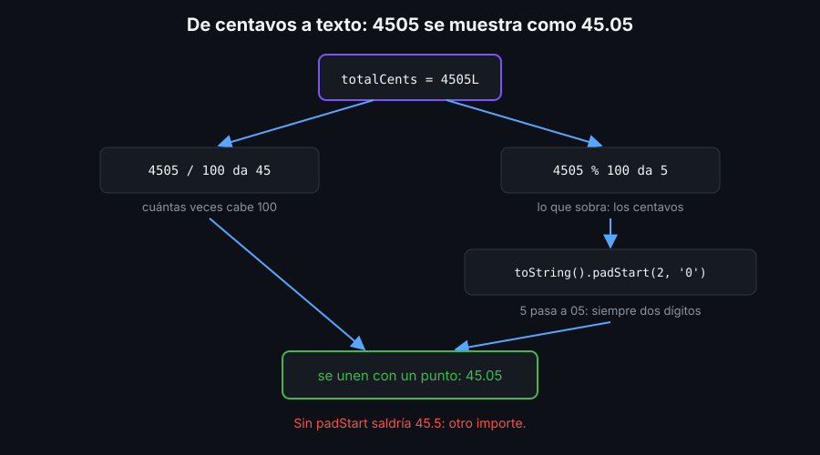

# Teoría 04 — Conversiones y dinero

## 🎯 Objetivos

- Convertir entre tipos numéricos con `toInt()`, `toLong()` y `toDouble()`.
- Convertir texto en número y número en texto.
- Explicar por qué `0.1 + 0.2` no da `0.3`.
- Guardar importes en centavos con `Long`, calcular un porcentaje redondeado y
  mostrarlo como `45.38`.

---

## 1. Qué problema resuelven las conversiones

Cada valor tiene un tipo fijo (Teoría 02), pero los datos cambian de forma: un texto
`"3"` escrito por alguien tiene que convertirse en el número `3` para sumarlo; un número
de unidades `Int` tiene que multiplicarse por un precio `Long`. Una **conversión** crea un
valor nuevo de otro tipo a partir de uno existente.

Kotlin **nunca** convierte solo entre tipos numéricos. Otros lenguajes lo hacen y así se
cuelan pérdidas de datos sin que nadie las vea. Aquí, cada conversión se escribe.

## 2. Cómo funciona

### 2.1 Sin conversiones implícitas

```kotlin
fun main() {
    val units: Int = 3
    val big: Long = units
    println(big)
}
```

```
E5.kt:3:19: error: initializer type mismatch: expected 'Long', actual 'Int'.
```

Aunque todo `Int` cabe en un `Long`, el compilador exige que lo pidas.

### 2.2 Funciones de conversión

Cada tipo numérico tiene funciones `toX()` que devuelven el valor convertido. Se
escriben con un punto detrás del valor: `units.toLong()`. Llamar a una función con
punto se lee "pídele a `units` su versión `Long`".

| Desde | Llamada | Resultado | Ojo |
| ----- | ------- | --------- | --- |
| `Int` | `3.toLong()` | `3` (`Long`) | Sin pérdida |
| `Int` | `3.toDouble()` | `3.0` | Sin pérdida |
| `Double` | `3.99.toInt()` | `3` | **Trunca**: descarta los decimales, no redondea |
| `Double` | `(-3.99).toInt()` | `-3` | Trunca hacia cero |
| `String` | `"42".toInt()` | `42` | Falla si el texto no es un número |
| `Int` | `42.toString()` | `"42"` | Siempre funciona |

La variable original no cambia: `toLong()` crea un valor nuevo.

```kotlin
fun main() {
    val units: Int = 3
    val big: Long = units.toLong()
    println(big)
}
```

Sale `3`.

### 2.3 De texto a número

Cuando los datos lleguen del teclado o de un archivo, llegarán como texto. `toInt()`
los convierte:

```kotlin
fun main() {
    val typed = "42"
    println(typed + 1)
    println(typed.toInt() + 1)
}
```

Sale `421` (texto pegado) y `43` (suma de verdad). Si el texto no es un número, el
programa compila pero se detiene al ejecutarse:

```kotlin
fun main() {
    println("4x".toInt())
}
```

```
Exception in thread "main" java.lang.NumberFormatException: For input string: "4x"
```

Por ahora, convierte solo textos que sabes que son números. En la semana 04 aprenderás a
convertir sin riesgo de que el programa se detenga.

### 2.4 Redondear en lugar de truncar

`toInt()` sobre un `Double` trunca. Para redondear al entero más cercano existe
`roundToInt()`, que vive en el paquete `kotlin.math` y hay que **importar**: avisar al
compilador de dónde sacarla, con una línea `import` al principio del archivo, antes de
`fun main()`.

```kotlin
import kotlin.math.roundToInt

fun main() {
    println(3.99.toInt())
    println(3.99.roundToInt())
    println(2.5.roundToInt())
}
```

```
3
4
3
```

## 3. Por qué el dinero no va en `Double`

### 3.1 El problema

```kotlin
fun main() {
    println(0.1 + 0.2)
    println(100.0 / 3)
}
```

```
0.30000000000000004
33.333333333333336
```

Un `Double` guarda los números en **binario** (base 2). Igual que 1/3 no se puede
escribir exacto en decimal (0,3333...), 0,1 no se puede escribir exacto en binario. La
JVM guarda la aproximación más cercana, y al sumar se acumula el error. Para una
distancia da igual; para un importe, un centavo que aparece o desaparece es un error de
contabilidad.

### 3.2 La solución: contar centavos

Un **entero** sí es exacto. Si guardas `12.50` como `1250` centavos, todas las sumas y
multiplicaciones son exactas. Y en `Long`, para no desbordar (Teoría 03).

```kotlin
fun main() {
    val unitPriceCents = 1250L        // ¿Qué? 12.50 expresado en centavos.
    val units = 3
    val subtotalCents = unitPriceCents * units
    println(subtotalCents)
}
```

Sale `3750`. `Long` por `Int` da `Long`: no hace falta convertir `units`.

### 3.3 Un porcentaje redondeado

Para un impuesto del 21 % sobre 3750 centavos, la cuenta exacta es 3750 × 21 / 100 =
787,5. Con enteros, `/` trunca y daría 787. La regla habitual es **redondear la mitad
hacia arriba**: 787,5 → 788. El truco es sumar la mitad del divisor antes de dividir:

```kotlin
fun main() {
    val subtotalCents = 3750L
    val taxRatePercent = 21
    println(subtotalCents * taxRatePercent / 100)
    println((subtotalCents * taxRatePercent + 50) / 100)
}
```

```
787
788
```

`+ 50` es la mitad de `100`: si los decimales llegan a ,5, el resultado sube al entero
siguiente; si no, se queda. Y multiplicar antes de dividir conserva toda la precisión
posible (Teoría 03).

### 3.4 Mostrar centavos como `45.38`

Guardas centavos, pero la persona quiere leer `45.38`. Separa la parte entera de los
centavos con `/` y `%`:



```kotlin
fun main() {
    val totalCents = 4505L
    println("${totalCents / 100}.${totalCents % 100}")
    println("${totalCents / 100}.${(totalCents % 100).toString().padStart(2, '0')}")
}
```

```
45.5
45.05
```

La primera línea está **mal**: el resto es `5` y se imprime como `5`, no como `05`.
`toString()` convierte el resto en texto y `padStart(2, '0')` lo rellena por la
izquierda con ceros hasta tener 2 caracteres. `${...}` mete el resultado de un cálculo
dentro de un string; lo verás a fondo en la [Teoría 05](05-strings-y-templates.md).

Esta línea es larga y la vas a repetir para cada importe. En la semana 03 la convertirás
en una función y la escribirás una sola vez.

## 4. Antipatrones

- ❌ **`toInt()` para redondear.** Trunca: `3.99.toInt()` es `3`.
- ❌ **Importes en `Double`.** Aparecen centavos fantasma.
- ❌ **Dividir antes de multiplicar en porcentajes.** `3750 / 100 * 21` da 777, no 788.
- ❌ **Imprimir el resto sin rellenar.** `45.5` en lugar de `45.05` es otro importe.

## 5. Trucos

- Pon la unidad en el nombre: `priceCents`, `weightKg`, `durationMinutes`. Así nunca
  sumas centavos con unidades enteras sin darte cuenta.
- Para el porcentaje, usa un `Int` con el número tal cual (`21`), no `0.21`: así todo
  el cálculo sigue siendo entero.

## ✅ Checklist

- [ ] Convierto con `toInt()`, `toLong()`, `toDouble()` y `toString()`
- [ ] Sé que `toInt()` trunca y que `roundToInt()` redondea (con su `import`)
- [ ] Explico por qué `0.1 + 0.2` no es `0.3`
- [ ] Guardo importes en centavos con `Long`
- [ ] Calculo un porcentaje redondeando la mitad hacia arriba
- [ ] Muestro centavos con dos decimales usando `/`, `%` y `padStart`

---

| Anterior | Actual | Siguiente |
| -------- | ------ | --------- |
| [← Teoría 03 — Operadores aritméticos](03-operadores-aritmeticos.md) | **Teoría 04 — Conversiones y dinero** | [Teoría 05 — Strings y templates →](05-strings-y-templates.md) |
